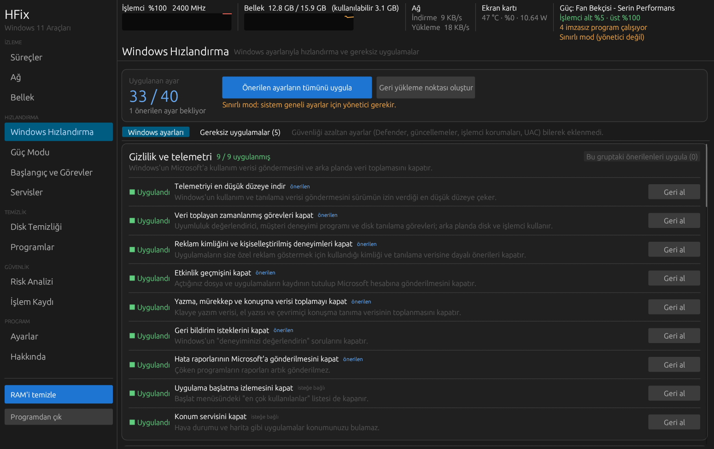

# HFix Windows 11 Araçları

Windows 11 için **ücretsiz ve açık kaynak** bakım, hızlandırma ve güvenlik aracı. Çalışan programları ve ağ kullanımını izler, RAM ve disk temizler, Windows'un telemetri ve reklam ayarlarını tek tıkla kapatır, başlangıç programlarını, zamanlanmış görevleri ve servisleri yönetir, şüpheli dosya ve ayarları tarar. Tek bir `.exe` dosyasıdır; reklam, deneme süresi ve hesap yoktur.

*English: [HFix Windows 11 Tools](#english) — a free, open-source Windows 11 optimizer, debloater and system monitor.*

> **Claude Fable 5.2 ile geliştirildi.** Bu programın kodu Anthropic'in Claude Fable 5.2 modeliyle yazıldı.

<p align="center"></p>

## İndir

[Releases](../../releases/latest) sayfasından **`HFixWin11.exe`** dosyasını indirip çalıştırın. Program kendini kurar: `%LOCALAPPDATA%\HFixWin11` klasörüne yerleşir, masaüstüne ve Başlat menüsüne **HFix Windows 11 Araçları** kısayolunu koyar. Ayrı kurulum dosyası ya da çalışma zamanı gerekmez. Sonraki sürümler kendiliğinden iner ([Otomatik güncelleme](#otomatik-güncelleme)).

- Program sistem ayarlarını değiştirebildiği için açılışta **yönetici izni** (UAC) ister.
- Henüz kod imzalı olmadığı için Windows SmartScreen ilk açılışta "Ek bilgi → Yine de çalıştır" sorabilir.
- Kaldırmak için: **Windows Ayarları → Uygulamalar → Yüklü uygulamalar → HFix Windows 11 Araçları → Kaldır**.
- **Windows 10 (sürüm 1809 ve sonrası) desteklenir.** Program Windows sürümünü kendisi algılar; Windows 10'da yalnızca Windows 11'de bulunan 9 ayarı (Recall, Widgets, eski sağ tık menüsü, görev çubuğu hizası vb.) göstermez. Diğer bütün özellikler iki sürümde de aynıdır.

## Özellikler

| Bölüm | Sayfa | Ne yapar |
|---|---|---|
| **İzleme** | Süreçler | İşlemci, bellek, disk ve ağ kullanımı; programı kısma, hızlandırma, sonlandırma; imzasız ve şüpheli programların renkle gösterimi |
| | Ağ | İnterneti kullanan programlar, indirme / yükleme hızları ve bağlantı sayıları |
| | Bellek | RAM temizliği ve önce / sonra karşılaştırması |
| **Hızlandırma** | Windows Hızlandırma | 70 Windows ayarı beş grupta: gizlilik ve telemetri, reklam / öneri / yapay zekâ (Copilot, Recall, Widgets), performans, görünüm, Microsoft Edge. Her ayar tek tıkla uygulanır ve geri alınır. Gereksiz Store uygulamalarını kaldırma |
| | Güç Modu | Sessiz, Akıllı, Performans ve En yüksek işlemci modları; fanı susturan otomatik kısma |
| | Başlangıç ve Görevler | Windows ile açılan programlar ve zamanlanmış görevler; güvensiz görünenlerin işaretlenmesi |
| | Servisler | Gruplanmış arka plan servisleri, toplu durdurma ve geri yükleme, imzasız servis dosyaları |
| **Bakım** | Disk Temizliği | Geçici dosyalar, önbellekler, güncelleme artıkları; kategori kategori ne kadar yer açılacağı |
| | Programlar | Yüklü programları kaldırma ve Windows araçlarına kısayollar |
| | Onarım ve Ağ | Sistem dosyası onarımı (SFC, DISM, disk denetimi), DNS sunucusu seçimi (Cloudflare, Google, Quad9, AdGuard, OpenDNS), ağ sıfırlama, saat eşitleme |
| **Güvenlik** | Risk Analizi | Çalışan süreçler, başlangıç kayıtları, servisler, görevler, geçici klasörler ve kritik Windows ayarlarında şüpheli olanların taranması; karantina, kalıcı silme, Microsoft Defender ile tarama |
| | İşlem Kaydı | Programın yaptığı her işlemin kaydı |

Ayrıca:

- **Geri alınabilir.** Hızlandırma ayarlarının ve servislerin önceki değerleri yedeklenir; "Geri al" eski değeri geri koyar. İstenirse önce sistem geri yükleme noktası oluşturulur.
- **Güvenliği azaltan ayar yok.** Defender'ı, Windows Update'i, işlemci korumalarını ya da UAC'yi kapatan ayarlar bilerek eklenmedi.
- **Sistem tepsisi.** Pencereyi kapatmak programı kapatmaz; tepside çalışmaya devam eder.
- **12 dil:** Türkçe, English, 简体中文, Español, Português (Brasil), Deutsch, Français, Русский, Italiano, 日本語, 한국어, العربية. Program Windows'un görüntüleme dilinde açılır (listede yoksa İngilizce). Açık / koyu tema Windows ayarını izler. İkisi de **Ayarlar** sayfasından değiştirilebilir.

Hızlandırma ayarları [Win11Debloat](https://github.com/Raphire/Win11Debloat), [AtlasOS](https://github.com/Atlas-OS/Atlas), [ReviOS](https://github.com/meetrevision/playbook) ve [WinUtil](https://github.com/ChrisTitusTech/winutil) projelerinin ayar kataloglarından derlenmiştir; onarım komutları ve DNS listesi WinUtil ile [Optimizer](https://github.com/hellzerg/optimizer) ile aynıdır.

## Otomatik güncelleme

Program açıldıktan 10 saniye sonra ve açık kaldıkça 6 saatte bir GitHub'daki son sürüme bakar; internete ulaşamazsa 10 dakika sonra yeniden dener. Yeni sürüm varsa arka planda indirir. **Hakkında → Yeniden başlat ve kur** düğmesine basınca ya da programı bir sonraki açışınızda yeni sürüm kurulur; ayarlarınız korunur. **Ayarlar → Yeni sürümleri otomatik indir** ile kapatılabilir; **Hakkında → Güncellemeleri denetle** her zaman çalışır.

Her sürümün yanında bir imza dosyası (`HFixWin11.exe.sig`) bulunur: sürüm numarasını, dosya boyutunu ve SHA-256 özetini bir Ed25519 anahtarıyla imzalar. Anahtarın açık yarısı programın içindedir. Program indirdiği dosyayı imza, sürüm numarası ve özet birebir tutmadıkça kurmaz; eski bir sürüm yeni diye sunulamaz. İndirme yalnızca HTTPS üzerinden yapılır.

## Kaynaktan derleme

[Rust](https://rustup.rs) gerekir; başka bir şey gerekmez (C derleyicisi, Node vb. yok).

```powershell
rustup toolchain install stable-x86_64-pc-windows-gnu
cargo +stable-x86_64-pc-windows-gnu build --release
```

Çıktı `target\release\HFixWin11.exe` dosyasıdır. Kurmadan denemek için `HFixWin11.exe --tasinabilir` ile çalıştırın: kendini kopyalamaz, kısayol oluşturmaz, güncelleme denetlemez.

| Dosya | İçerik |
|---|---|
| `src/main.rs` | Pencere, sol menü, süreç ve ağ tabloları |
| `src/mon.rs`, `src/win.rs` | Ölçümler ve Windows API bağlantıları (ek kütüphane olmadan, doğrudan FFI) |
| `src/tweak.rs`, `src/ui4.rs` | Windows Hızlandırma ayarları ve sayfası |
| `src/risk.rs`, `src/sig.rs` | Risk taraması ve dijital imza denetimi |
| `src/svc.rs`, `src/tasks.rs`, `src/startup.rs` | Servisler, zamanlanmış görevler, başlangıç kayıtları |
| `src/clean.rs`, `src/apps.rs` | Disk temizliği ve yüklü programlar |
| `src/update.rs` | Güncellemenin imza, sürüm ve özet denetimi (`cargo test`) |
| `src/install.rs` | Kendi kendine kurulum, kısayollar, kaldırma |
| `src/stamp.rs` | Derlenen exe'ye sürüm bilgisi ve simge ekleme (kaynak derleyicisi gerekmez) |
| `src/lang.rs`, `diller/` | Arayüz dilleri: metinler kodda Türkçe ve İngilizce, diğer diller `diller/<kod>.json` (İngilizce metin → çeviri). Yeni metinleri listelemek için `python tools/metinler.py cikar`, çevirileri denetlemek için `python tools/metinler.py denetle` |
| `src/fonts.rs` | Çince, Japonca, Korece ve Arapça için Windows yazı tiplerini yükleme |

### Sürüm yayımlama

`Cargo.toml` içindeki `version` satırı artırılıp `main` dalına gönderilir. [GitHub Actions iş akışı](.github/workflows/surum.yml) programı derler, testleri çalıştırır, exe'yi imzalar ve `v<sürüm>` etiketli sürümü iki dosyasıyla (`HFixWin11.exe`, `HFixWin11.exe.sig`) yayımlar. Kurulu programlar yeni sürümü kendiliğinden indirir.

Aynı iş elle de yapılabilir (Actions kullanılamadığında): sürüm artırılıp commit edildikten sonra

```powershell
powershell -ExecutionPolicy Bypass -File yayimla.ps1 -Anahtar <gizli anahtar dosyası>
```

programı derler, test eder, imzalar, imzayı programdaki açık anahtarla doğrular ve sürümü yayımlar.

İmza anahtarının gizli yarısı depoda durmaz; iş akışı onu `HFIX_IMZA_ANAHTARI` adlı depo sırrından okur. Anahtar `HFixWin11.exe --anahtar-uret <dosya>` ile bir kez üretilmiştir. Kaybolursa yeni anahtarla imzalanan sürümleri kurulu programlar kabul etmez.

## Kod imzalama politikası

*Code signing policy.* Yayımlanan exe henüz Authenticode ile imzalı değildir; ücretsiz açık kaynak imzalama için [SignPath Foundation](https://signpath.org) başvurusu hazırlanmaktadır. Kaynak, derleme, roller ve gizlilik beyanı için: [CODE_SIGNING_POLICY.md](CODE_SIGNING_POLICY.md). Exe; ürün adı, sürüm ve yayıncı bilgisini içinde taşır (Özellikler → Ayrıntılar).

## Lisans

[MIT](LICENSE) © HukukFix

---

## English

**HFix Windows 11 Tools** is a free, open-source maintenance, speed-up and security utility for Windows 11, written in Rust. It is a single `.exe` with no ads, trial period or account.

- **Monitor** — processes with CPU, memory, disk and per-process network use; throttle, boost or end a program; unsigned and suspicious programs are highlighted. RAM cleaner with a before / after comparison.
- **Speed up** — 70 Windows tweaks in five groups (privacy and telemetry; ads, suggestions and AI such as Copilot, Recall and Widgets; performance; appearance; Microsoft Edge), each applied and undone with one click. Remove bloatware Store apps. CPU power modes, startup programs, scheduled tasks and Windows services.
- **Clean up** — temporary files, caches and update leftovers; uninstall programs.
- **Security** — a risk scan over running processes, startup entries, services, tasks, temp folders and critical Windows settings, with quarantine, permanent deletion and a Microsoft Defender scan.

Everything is reversible: previous values are backed up and restored by "Undo". Tweaks that weaken security (disabling Defender, Windows Update, CPU mitigations or UAC) are deliberately left out.

**Install:** download **`HFixWin11.exe`** from [Releases](../../releases/latest) and run it. It also runs on Windows 10 (1809 or later), where the 9 tweaks that exist only on Windows 11 are hidden automatically. It installs itself to `%LOCALAPPDATA%\HFixWin11`, puts a shortcut on the desktop and in the Start menu, and asks for administrator rights (UAC) on start because it changes system settings. New versions are downloaded automatically and installed only if their Ed25519 signature, version and SHA-256 digest match. The interface is available in 12 languages (Turkish, English, Simplified Chinese, Spanish, Brazilian Portuguese, German, French, Russian, Italian, Japanese, Korean, Arabic) and opens in the Windows display language; language and light / dark theme can be changed under **Settings**.

**Build:** `cargo +stable-x86_64-pc-windows-gnu build --release` (Rust only, no other dependencies).

The tweak catalogue draws on [Win11Debloat](https://github.com/Raphire/Win11Debloat) and [AtlasOS](https://github.com/Atlas-OS/Atlas).
